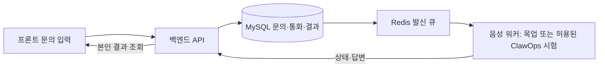

# 백엔드 문서 안내

학부모의 문의를 접수하고, 음성 워커가 얻은 학원 답변을 문의자별로 저장·조회하는 FastAPI·MySQL·Redis 기반 개발본이다. 공동 API·큐·워커가 배포되어 있으며 운영 음성 엔진은 ClawOps다. 코드·배포 검사와 실제 전화·음성 품질 시험 결과는 구분한다.

## 읽는 순서

| 문서 | 확인할 내용 |
|---|---|
| [실행 안내](../backend/README.md) | 설치·환경 설정·서버 및 자체 목업 실행 |
| [팀원 PC 실행·시험](collaboration/README.md) | Vite 5173번, 공동 API 연결, 개인 Docker 환경 |
| [ClawOps 운영 기준](음성_엔진_운영기준.md) | 현재 실행 경로, 설정, 과거 비교 자료 구분 |
| [API와 파트 연결](api/README.md) | 프론트·음성 요청, 결과 규칙, 연결 전 해결할 문제 |
| [데이터 사전](database/data-dictionary.md) / [SQL](database/schema.sql) | 테이블·필드·관계와 생성 정의 |
| [검증 결과](verification/backend.md) | 실제 시험 결과와 미검증 범위 |

## 데이터 흐름

공동 환경은 실제 HTTP 워커를 사용한다. 일반 목업 요청은 합성 답변으로 처리하며, 실제 전화는 지정 계정·허용 번호·활성화 조건을 갖춘 별도 시험이다.

현재 SQLAlchemy 정의는 25테이블·149필드·25개 외래키다. 문의자→문의→질문/통화→진행 이벤트/결과/질문별 답변을 중심으로 계정·세션·학원 소유 관계·학원 설정·큐 전달·재검토·과거 제공업체 기록을 관리한다. w5_/w6_ 접두사는 개발 이력이며 주차별 별도 운영 DB를 뜻하지 않는다.

이 문서는 현 구현의 검토 기준이다. 개발 정책 수치·파트 간 계약은 팀 검토 후 확정하며, 업로드를 배포·실통화 성공으로 표시하지 않는다. 상세 ERD·참고 화면·과거 검증 자료는 로컬 프로젝트 폴더와 이전 커밋에 보존했다.
