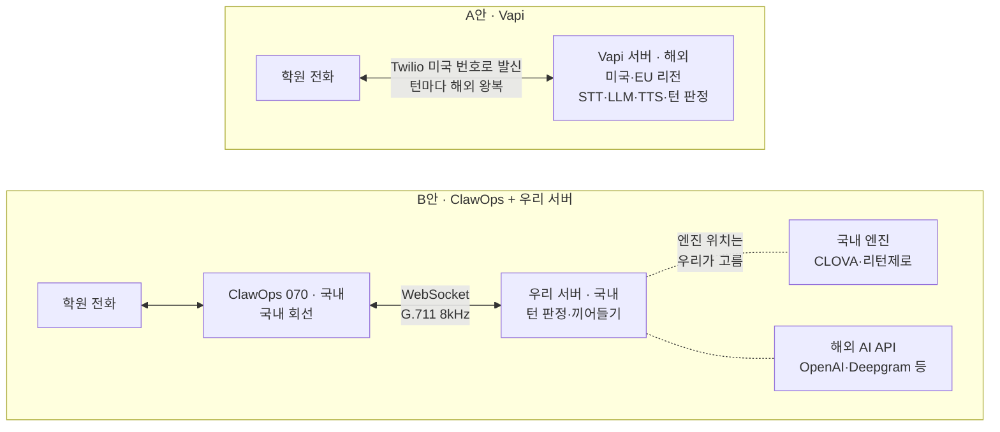

# 음성 에이전트 도구 선정 조사

Oct 7, 2026 · @규림

> 원본: [Claude Docs](https://claude.ai/code/artifact/d85caa63-bddf-4cce-96dc-d0575be9234e) · 2026-10-11 사본(rev 43). 원본을 고치면 이 파일도 다시 내보낸다.

조사한 범위에서, 한국 070 발신과 한국어 실시간 대화를 한 번에 지원한다고 문서에 밝힌 곳은 ClawOps 에이전트 SDK 하나다. 다만 SDK에서 검증 완료된 엔진은 OpenAI Realtime뿐이고, 10/7 체험 통화에서 응답 중앙값은 2.0초였고, 설정을 바꾼 통화에서는 1.56초까지 줄었다. Vapi는 붙이기 가장 쉽지만 서버가 미국·EU뿐이고 한국 발신번호를 자체로 주지 않는다.

두 경로를 약 10만 원(예산 50만 원의 20%)으로 유료 시험하고, 같은 시나리오의 실통화 지연(p95)으로 고르기를 권한다. 합격선 1.5초는 SKT가 '모두의 AI' 대신 걸기 인터뷰에서 좋은 수준으로 든 1\~1.5초와 같은 선이다. 같은 날 Vapi 웹 통화는 추론 High에서 중앙값 1.7초였지만, 녹음 위치와 대본이 달라 참고값이다.

## 후보 도구

070 발신과 통화 중 실시간 대화를 둘 다 노릴 수 있는 경로는 세 가지다. 실통화 지연은 ClawOps 에이전트만 10/7 체험으로 처음 재었다(아래 체험 통화 측정).

| 경로 | 서버 위치 | 한국 번호·발신 | 비용 (통화 1분) | 걸리는 점 |
| --- | --- | --- | --- | --- |
| A안 [Vapi](https://docs.vapi.ai/advanced/sip/sip-trunk) | 미국, EU 선택. 아시아 리전 없음 | 무료 번호는 미국 번호이고 발신 불가. Twilio 번호를 가져오거나 BYO SIP 트렁크로 연결 | 약 $0.13\~0.18 (플랫폼 $0.05 + STT·LLM·TTS + Twilio 한국 휴대폰 $0.0524) | 턴마다 음성이 미국 서버를 거친다. 통화 음성·전사가 해외에서 처리된다 |
| B안 [ClawOps](https://claw-ops.com/) + 자체 파이프라인 | 회선·미디어는 국내(서비스 소개 기준). STT·LLM·TTS 위치는 우리가 고름 | 070 직접 발급, 발신 지원. 통화 오디오가 우리 서버 WebSocket으로 들어옴 | 개인 플랜 ₩19,000/월(발신 100분, 동시 1) + 부가 ₩10\~200/분 + AI API | 직접 만들면 턴 판정·끼어들기를 우리가 구현한다. 에이전트 SDK를 쓰면 발신과 턴 판정이 붙지만 검증 완료 엔진은 OpenAI Realtime뿐이다. 공개 고객사가 없다 |
| C안 [ClawOps SIP 트렁크](https://platform.claw-ops.com/docs/sip-trunk) → OpenAI Realtime·ElevenLabs | 회선은 국내, AI는 해외 | 070 수신 연결만 문서에 있음. 발신은 미확인 | SIP 직접연결 ₩99,000/월 + AI 사용료 | 월 ₩99,000(예산의 20%)이 든다. 같은 OpenAI Realtime은 에이전트 SDK로 SIP 직접연결 없이 붙는다 |

9/29 회의에서 "OpenAI Realtime은 070에 직결할 수 없다"고 한 발언은 정정한다. ClawOps는 SIP 직접연결(월 ₩99,000)로 070 → OpenAI Realtime 연결을 문서로 지원하고, [에이전트 SDK](https://platform.claw-ops.com/docs/voice-agent)로는 `agent.call()` 발신까지 붙일 수 있다.

10/8 ClawOps 답변(메일)으로 Vapi를 070에 붙이는 길이 확인됐다. SIP 직접연결은 개인 요금제에도 붙고(월 ₩99,000, 부가세 포함, 체험판 불가), 외부 플랫폼이 TLS 5061·Digest 인증으로 접속하면 보유한 070으로 국내 휴대폰에 걸 수 있다. 다만 Vapi 조합은 ClawOps가 검증한 가이드가 없고, SIP로 건 통화도 개인 요금제의 발신 100분에서 차감되며 초과 사용은 되지 않는다.

## 선정 이유

필수 조건인 한국 070 발신과 통화 중 실시간 오디오를 함께 채우는 국내 회선은 ClawOps뿐이었다. 대화 엔진을 구간별로 바꿔 가며 지연을 비교할 수 있는 폭은 Vapi가 가장 넓어, 회선은 ClawOps, 비교 기준 엔진은 Vapi로 골랐다.

| 후보 | 070 발신 | 통화 중 실시간 오디오 | 엔진 교체 | 바로 시험 | 빠진 이유 |
| --- | --- | --- | --- | --- | --- |
| [ClawOps](https://claw-ops.com/) | O 셀프 발급 | O WebSocket 스트림 | O 직접 구성·SDK | O 카드 없이 3일 | — |
| [Vapi](https://docs.vapi.ai/advanced/sip/sip-trunk) | X (SIP로 연결) | O | O STT·LLM·TTS 각각 | O $5 크레딧 | — |
| [Retell AI](https://didlogic.com/learn/connecting-ai-voice-platforms-via-sip-vapi-retell-livekit-and-elevenlabs/) | X | O | △ 묶음 구성 | O | 엔진 교체 폭이 좁아 비교 실험이 어렵다 |
| [ElevenLabs Agents](https://didlogic.com/learn/connecting-ai-voice-platforms-via-sip-vapi-retell-livekit-and-elevenlabs/) | X | O | △ | O | 강점이 TTS라 TTS만 떼어 쓰는 편이 낫다 |
| [OpenAI Realtime 직결](https://developers.openai.com/api/docs/guides/realtime-sip) | X | O | X 단일 모델 | O | Opus·TLS·SRTP를 요구해 국내 G.711 회선과 바로 붙지 않는다 |
| [LiveKit](https://didlogic.com/learn/connecting-ai-voice-platforms-via-sip-vapi-retell-livekit-and-elevenlabs/) | X | O | O | △ | 오픈소스라 서버와 SIP를 우리가 다 세워야 한다 |
| Twilio·Telnyx | X 한국 070 없음 | O | — | O | 미국 번호라 국제전화로 걸린다. Telnyx 무료 계정은 음성 기능이 막혀 있었다 |
| 일반 인터넷전화 070 | O | △ API·문서 부족 | — | X 상담·계약 | 개통까지 오래 걸려 학기 일정과 맞지 않는다 |
| 리턴제로·[CLOVA](https://www.ncloud.com/product/aiService/csr) | — | — | STT·TTS 전용 | △ | 전화 연동이 없어 엔진 후보로만 쓴다 |

- **회선: ClawOps.** 국내 070 번호를 가입 즉시 셀프로 받는다. ClawOps 개발자는 Twilio·Vonage가 한국 070을 주지 않는 점을 만든 이유로 들었다([OKKY 개발 후기](https://okky.kr/articles/1552946)). 통화 중 음성을 WebSocket으로 우리 서버에 실시간으로 넘겨 끼어들기·DTMF 이벤트까지 다루고, 회선과 음성은 국내 서버에서 처리된다. 녹음은 무료, 개인 플랜은 월 ₩19,000이다.
- **엔진: Vapi.** STT·LLM·TTS를 각각 골라 바꿀 수 있어, 1.5초 목표를 구간별로 쪼개 보고 엔진을 비교할 수 있다. 이 구조가 논문 실험과 맞는다. 말 끝 대기·끼어들기 기준, ARS, 함수 호출을 통한 백엔드 DB 연동까지 설정할 수 있고, 월 100만 분 이상 발신하는 운영 사례([Instawork](https://vapi.ai/blog/case-study-instawork))가 있다.
- **일정·예산.** 둘 다 계약 없이 10/7 바로 가입해 실측까지 마쳤고, 지금까지 든 비용은 0원이다.

**약점**

- **ClawOps.** 공개 고객사가 없는 신생 서비스다. SDK에서 검증된 엔진은 OpenAI Realtime뿐이고, Vapi와 SIP로 이어 거는 방식은 10/8 문의에서 가능하다는 답을 받았지만 검증된 가이드는 없다([SIP 트렁크 문서](https://platform.claw-ops.com/docs/sip-trunk)).
- **Vapi.** 서버가 미국·EU에만 있고 한국 번호를 직접 주지 않으며, 음성·전사가 해외에서 처리된다.

## 체험 통화 측정

ClawOps 체험 에이전트와 한 통화 2건에서, 담당자 말이 끝난 뒤 AI가 대답을 시작하기까지 중앙값 2.0초가 걸렸다. 18번 모두 목표 1.5초를 넘었다. 설정을 바꾼 세 번째 통화(live·luna·낮음)는 중앙값 1.56초였다.

| 통화 | 길이 | 응답 수 | 평균 (초) | 중앙값 (초) | 최대 (초) | 1.5초 넘음 |
| --- | --- | --- | --- | --- | --- | --- |
| ClawOps 070 · gpt-realtime-2.1 통화 1 | 2분 10초 | 7 | 1.91 | 1.76 | 2.65 | 7 |
| ClawOps 070 · gpt-realtime-2.1 통화 2 | 4분 7초 | 11 | 2.13 | 2.14 | 2.73 | 11 |
| ClawOps 070 · gpt-realtime-2.1 합계 | 6분 17초 | 18 | 2.05 | 2.03 | 2.73 | 18 |
| ClawOps 070 · live·luna·낮음 | 1분 48초 | 8 | 1.92 | 1.56 | 4.16 | 5 |
| Vapi 웹 · 추론 High (참고) | 1분 55초 | 6 | 1.70 | 1.68 | 2.15 | 3 |
| Vapi 웹 · 추론 Low (참고) | 52초 | 2 | 2.14 | 2.14 | 2.21 | 2 |

ClawOps는 서버 녹음이라 휴대폰망 구간이 빠져 있어, 담당자가 실제로 기다리는 시간은 이보다 길다. 표본이 18개라 p95는 최댓값 2.73초와 같다. Vapi는 웹 통화를 휴대폰으로 녹음해 인터넷 왕복이 들어 있고 대본도 달라, 참고값으로만 본다. 엔진은 ClawOps가 gpt-realtime-2.1(음성→음성), Vapi가 GPT Live와 GPT-5.6 Terra(추론 High·Low) 조합이라, 플랫폼과 모델 구조가 함께 달랐다.

- **측정 방법.** ClawOps 서버 녹음(WAV 8kHz 모노, 양쪽 목소리 한 파일)을 음성 구간으로 나누고(silero VAD), 목소리 특징으로 AI와 사람을 가른 뒤(ERes2Net 화자 임베딩), 사람 말이 끝난 지점부터 AI 첫 소리까지를 10ms 단위로 재었다. 말 사이 무음이 디지털 0이라 경계가 뚜렷하다. Vapi는 휴대폰 녹음을 같은 방법으로 재고, 화자는 전사로 확인했다.
- **첫인사 공백.** 담당자가 "여보세요"라고 한 뒤 AI 첫인사까지 2.0초, 1.8초가 비었다. 실제 학원에서는 이 사이에 끊길 수 있어, 연결되자마자 첫인사를 내보내는 설정이 필요하다.
- **끼어들기.** 담당자가 말을 끊은 3번 모두 AI가 0.4\~1.0초 더 말한 뒤 멈췄다(화자 분리로 잡은 근삿값). Vapi 웹 통화에서는 담당자의 맞장구 '네'를 끼어들기로 받아, AI가 하던 질문을 끊고 처음부터 다시 물었다. Vapi는 멈추기 전에 들을 단어 수(Stop Speaking Plan의 numWords)가 기본 0이라, 이 값을 올려 다시 시험한다([Vapi 음성 설정](https://docs.vapi.ai/customization/speech-configuration)).
- **되짚기와 정정.** 금액(28만 원, 교재비 1만 5천 원)과 시간(화·목 오후 7시 30분\~9시 30분)을 그대로 되짚었고, 목요일을 금요일로 고친 것도 반영했다. 통화 2는 여섯 문항을 질문 순서대로 요약했다.
- **마무리 인사.** 통화 2는 담당자가 "네, 맞습니다"라고 한 뒤 1.9초 만에 녹음이 끝나 AI가 인사할 틈이 없었다. 응답에 2초을 걸리므로, 요약을 확인하는 질문에 인사를 붙여 한 번에 말하게 하기를 권한다.
- **추측 의심.** 통화 2에서 담당자가 끼어든 직후 AI가 "레벨 테스트가 있다는 말씀이죠?"라고 물었는데, 전사에는 담당자가 있다고 답한 말이 보이지 않는다. 답을 지어냈는지 다시 확인할 항목이다.
- **추론 Low(Vapi).** Vapi에서 추론을 High에서 Low로 낮춘 통화는 빨라지지 않았다(응답 2번, 2.07·2.21초). 질문을 하나만 했고, "\~라는 말씀이죠?"라고 되물은 뒤 답을 기다리지 않고 0.5초 만에 요약과 인사로 넘어갔다. 되짚을 때 요일을 하나 더 붙였는지도 녹음으로 확인할 항목이다.
- **설정 비교(ClawOps).** live·luna·낮음 통화는 응답 중앙값 1.56초로 gpt-realtime-2.1 통화(2.03초)보다 0.5초 빨랐고, 되짚기·빠진 답 다시 묻기·요약 확인·마무리 인사를 모두 했다. 다만 두 가지를 함께 물은 질문에 한쪽만 답하자 4.16초를 기다렸고, 이 한 번을 빼면 중앙값은 1.52초다. '낮음'이 턴 판정 민감도라면 말이 덜 끝났다고 보고 더 기다린 것일 수 있다.
- **다음 시험.** 지연은 추론보다 말 끝 판정 대기에서 더 많이 생길 수 있다. Vapi의 Start Speaking Plan(기본 대기 0.4초, 전사에 구두점이 없으면 1.5초)과 ClawOps의 턴 판정(semantic VAD eagerness)을 바꿔 가며 같은 대본으로 다시 잰다. 대시보드에 설정이 없으면 SDK로 한다.

## 국내에서 걸리는 조건

근거를 정리하면 걸리는 조건은 여섯 가지다. 이 중 한국 발신번호와 서버 위치가 도구 선택을 가장 크게 좌우한다.

1. **한국 발신번호.** Vapi가 무료로 주는 번호는 미국 번호이고 발신이 막혀 있다([Vapi 아웃바운드 문서](https://docs.vapi.ai/calls/outbound-calling)). 실통화 시험은 Twilio 번호를 가져와 한국 발신 권한을 켜고 건다. ClawOps 개발자는 Twilio·Vonage가 한국 070을 발급하지 않는 점을 서비스를 만든 이유로 들었다([OKKY 개발 후기](https://okky.kr/articles/1552946)).
   - 미국 번호는 내부 시험에만 쓰고, 실제 학원 발신은 070으로 한다.
2. **서버 위치와 지연.** Vapi는 미국·EU 리전만 있고, 턴 판정·끼어들기를 처리하는 오케스트레이션은 Vapi 인프라에서만 돈다([Vapi 데이터 흐름](https://docs.vapi.ai/security-and-privacy/data-flow)). 그래서 서울↔미국 왕복이 턴마다 붙는다. 늘어나는 폭은 서울에서 api.vapi.ai 왕복 시간을 재서 확인한다.
3. **개인정보 국외 이전.** A안은 학원 담당자의 음성과 전사가 해외에서 처리된다. 녹음 저장소 지역은 지정할 수 있지만 처리 위치는 미국·EU 중에서만 고른다. 국외 이전 고지·동의가 필요한지는 기업 정책 확인이 필요하다.
   - B안도 해외 AI API를 쓰면 그 구간은 같은 문제가 생긴다.
4. **ARS(DTMF).** 학원 대표번호가 ARS로 받으면 번호를 눌러 넘어가야 한다. Vapi는 IVR 내비게이션과 DTMF를 지원하고([Vapi IVR 문서](https://docs.vapi.ai/ivr-navigation)), ClawOps 스트림도 양방향 dtmf 메시지를 준다([VoiceML Stream 프로토콜](https://platform.claw-ops.com/docs/voiceml-stream-protocol)).
5. **상대가 AI일 때.** 학원용 AI 상담원이 이미 학부모 문의를 받고 있다([Vox.ai 학원 솔루션](https://www.tryvox.co/industries/education)). 우리 AI가 AI 상담원과 통화하는 경우를 테스트 시나리오에 넣는다.
6. **수신 거부.** Google Ask for Me는 자동 통화임을 밝히고, 업체가 AI 전화를 거부할 수 있게 했다([Android Authority](https://www.androidauthority.com/google-search-ask-for-me-3521795/)). 거부한 학원을 발신 큐에서 빼는 기능을 백엔드와 맞춘다.

## 음성이 지나가는 길

A안은 턴마다 음성이 해외 서버를 거치고, B안은 회선과 턴 판정이 국내에 있다. (원본 그림을 md용으로 옮겼다. 점선은 고를 수 있는 엔진이다.)



A안은 학원 담당자가 말을 마칠 때마다 음성이 해외 서버를 다녀와야 답이 나온다. B안은 회선과 턴 판정이 국내에 있고, STT·TTS를 국내 엔진(CLOVA·리턴제로)으로 고르면 음성도 국내에 남는다. 에이전트 SDK로 OpenAI Realtime을 쓰면 턴 판정도 해외에서 일어난다.

## 유료 시험 계획

두 경로를 같은 시나리오로 실통화해 p95 지연으로 고르기를 권한다. 비용은 약 10만 원이고, 멘토 승인이 있어야 시작할 수 있다.

### 1. 측정 방법

A안과 B안을 각각 팀원 휴대폰에 10통씩 걸고, 통화 녹음 파형에서 지연을 잰다. 통화당 발화 5회 이상에서 모아 평균과 p95를 낸다.

```latex
L = t_1 - t_0, \qquad p_{95}(L) \le 1.5\ \mathrm{s}
```

t0는 상대(시험에서는 팀원) 발화의 음성이 끊긴 시점, t1은 AI 첫 오디오가 나온 시점이다. 합격선을 p95 1.5초로 볼지는 멘토 확인이 필요하다.

- **시나리오.** 정상 응답(질문 2개)과 끼어들기를 경로마다 5통씩 건다.
- **구간 분해.** 지연을 발화 종료 판정 대기 · STT 최종화 · LLM 첫 토큰 · TTS 첫 오디오로 쪼갠다. 플랫폼 로그에 네 구간이 따로 나오는지도 비교 항목이다.
- **거리 몫.** 서울에서 api.vapi.ai 왕복 시간을 따로 재서, A안 지연 중 미국 왕복이 차지하는 몫을 분리한다.
- **녹음 위치.** ClawOps 통화 녹음은 서버에서 양쪽 목소리를 WAV 8kHz 모노 한 파일로 남긴다([통화 녹음 문서](https://platform.claw-ops.com/docs/call-recording)). 휴대폰망 구간이 빠지므로 휴대폰 쪽 통화 녹음과 함께 잰다.
- **체험 활용.** ClawOps 체험은 가입 후 3일간 발신 10분, 수신 무제한 무료다([요금](https://claw-ops.com/)). 대화 지연은 팀원이 070으로 거는 수신 통화로 먼저 재고, 발신 10분은 발신 흐름 확인에 쓴다.

### 2. 비용

| 항목 | 내용 | 금액 (1,400원/$) |
| --- | --- | --- |
| A안 Vapi 크레딧 | 플랫폼·STT·LLM·TTS. 분당 최대 $0.13 기준 약 230분 | $30 ≈ 4.2만 원 |
| A안 Twilio | 번호 1개 + 한국 휴대폰 발신 100분 | $6.4 ≈ 0.9만 원 |
| B안 ClawOps | 개인 플랜 1개월(발신 100분, 동시 1) | 1.9만 원 |
| B안 AI API | STT·LLM·TTS 크레딧 상한 | 3만 원 이내 |
| 합계 | 예산 50만 원의 20% | 약 10만 원 |

측정에 드는 통화는 10통 × 2분 = 경로당 약 20분이라, 나머지는 개발 중 시험 통화에 쓴다. 통화 길이 2분은 가정이다. 계정은 팀 공용 이메일로 만들고 멘토 쪽에서 충전하는 방식을 제안한다.

### 3. 분담과 순서

1. ClawOps Trial(카드 없이 3일, 발신 10분)로 WebSocket 오디오를 주고받는 최소 예제를 만든다. 김규림.
2. 승인되면 Vapi 크레딧과 Twilio 번호로 A안 실통화 10통을 잰다. 강유준.
3. ClawOps 개인 플랜으로 B안 실통화 10통을 잰다. 김규림.
4. 두 결과로 비교표를 갱신하고 Oct 14, 2026 회의에서 도구를 확정한다.

분담은 제안이며 오늘 회의에서 정한다. C안의 SIP 직접연결은 월 ₩99,000이라 이번 시험에서 뺀다. 같은 OpenAI Realtime은 B안 에이전트 SDK로 시험한다.

## 선행 사례

조사한 범위에서, 학원에 대신 전화해 문의하는 서비스는 찾지 못했다. 대신 거는 서비스는 미국에서 먼저 나왔고, 학원 쪽에서는 AI가 이미 전화를 받고 있다. 가장 가까운 선례는 Google Ask for Me이고, 학원이 아니라 미국의 지역 업체에 건다는 점에서 우리 과제와 갈린다.

| 범주 · 사례 | 하는 일 | 우리 과제와 다른 점 |
| --- | --- | --- |
| 대신 걸기 · [Google Ask for Me](https://techcrunch.com/2025/01/30/googles-ask-for-me-feature-calls-businesses-on-your-behalf-to-inquire-about-services-pricing/) | 네일숍·자동차 정비소에 대신 전화해 가격과 예약 가능 여부를 묻고 요약해 준다. 2026년 5월 I/O에서 홈서비스 확대와 미국 전국 출시를 발표했다([JobNimbus](https://www.jobnimbus.com/blog/google-ai-calling-home-services)) | 업종이 다르다. 자동 통화임을 밝히고 업체가 수신을 거부할 수 있다 |
| 대신 걸기 · [SKT 모두의 AI](https://v.daum.net/v/20260923110149976) | 10월 '대신 걸기'·'대신 받기' 시범, 12월 정식 출시 예정. KTX·굿닥 등과 API로 연동해 예약·결제까지 처리 | 범용 비서다. 응답 지연 목표로 1\~1.5초를 제시했다 |
| 대신 걸기 · [티티테라 AI 콜 에이전트](https://www.mt.co.kr/industry/2026/02/13/2026021210175182427) | 한국어 요청을 받아 해외 식당·숙소에 현지어로 예약 전화(15개 언어). 2026년 2월 공개, 시연 단계 | 해외 업체 대상이다. 받는 쪽도 AI인 통화를 언급했다 |
| 대신 받기 · [Vox.ai 학원 솔루션](https://www.tryvox.co/industries/education) | 학원용 AI 상담원. 학부모 문의 응대, 상담 예약, 리마인드 발신. 더스윙·파워큐브·세종네트웍스·교원을 고객으로 언급, 전 업종 누적 64만 콜 | 학원이 받는 쪽이다. 우리 AI의 통화 상대가 될 수 있다 |
| 대량 발신 · [CLOVA 케어콜](https://www.newspim.com/news/view/20240905000213) | 독거노인 안부 확인 AI 전화. 2024년 9월 기준 229개 시군구 중 128곳 도입, 이용자 3만 명, 응답률 96% | 정해진 대상에게 거는 안부 전화다. 묻고 답을 기록하는 구조는 같다 |
| 도구 사례 · [Vapi × Instawork](https://vapi.ai/blog/case-study-instawork) | 시간제 인력 스크리닝 발신. 월 100만 분 이상, 하루 약 16,000건 승인 | 영어 통화다. Vapi의 한국어 운영 사례는 공개 자료에서 찾지 못했다 |

CLOVA 케어콜의 응답률 96%는 국내에서도 AI가 거는 전화가 받아들여진다는 근거다. Google·SKT의 출시와 함께 논문 서론의 시장 근거로 쓴다.

## 범위와 제약

이번 시험은 두 경로의 실통화 지연 비교에 한정하고, 도구는 Oct 14, 2026 회의에서 확정한다.

| 구분 | 항목 |
| --- | --- |
| 반드시(이번 시험) | 두 경로 실통화 p95 지연, 정상 응답·끼어들기 시나리오, 구간별 지연 분해 |
| 시간이 되면 | ARS(DTMF) 통과, 상대가 AI 상담원인 통화, 한국어 STT 엔진 비교 |
| 향후 과제 | 수신 거부 목록 연동, 국외 이전 고지 문구, 동시 통화 확장 |

B안 구성: ClawOps 070 → 우리 서버(WebSocket, G.711 μ-law 8kHz, 20ms 프레임) → STT·LLM·TTS API. 끼어들기는 스트림의 `clear` 이벤트로 출력 버퍼를 비워 처리한다([VoiceML Stream 프로토콜](https://platform.claw-ops.com/docs/voiceml-stream-protocol)).

**걸리는 점**

- **서비스 지속성.** ClawOps는 공개 고객사가 없는 신생 서비스이고 요금도 베타 가격이다. 서비스 지속성과 SLA를 보장받기 어렵다.
- **구현 일정.** B안을 직접 파이프라인으로 만들면 턴 판정·끼어들기 구현에 일정이 밀릴 수 있다. 밀리면 ClawOps 에이전트 SDK(OpenAI Realtime)로 시나리오부터 검증한다.
- **지연 근거.** 9/28 브라우저 통화는 회선 구간이 빠져 있어 지연 근거로 쓰지 않는다.

**확인할 것**

- [ ] 멘토: 두 경로 유료 시험 승인과 계정 명의
- [ ] 멘토: 학원 담당자 음성·전사를 해외에서 처리해도 되는 범위
- [ ] 멘토: 합격 기준을 p95 1.5초로 잡아도 되는지
- [ ] ClawOps: 070 발신을 외부 SIP(Vapi BYO SIP 트렁크)로 받을 수 있는지, 발신용 SIP 호스트와 digest 인증정보를 주는지 → 10/8 답변: 가능(TLS 5061, Digest). 남은 것: TLS로 접속할 때 음성을 SRTP로 받는지(Vapi는 TLS를 쓰면 SRTP로 보냄)
- [ ] ClawOps: 에이전트 SDK를 쓰면 AI 에이전트 사용료(₩10\~200/분)가 붙는지
- [ ] ClawOps: 서버 리전과 WebSocket 스트림 지연 수치 → 10/14 답변: 에이전트는 GCP 서울 리전(asia-northeast3), OpenAI 서버 위치는 특정 불가. GPT-Live 에이전트는 입력을 100ms 단위로 묶고 출력 시작 때 100ms(평균 약 80ms)를 쌓음. WebSocket 스트림 지연은 아직 안 물어봄
- [ ] ClawOps: 학생 팀 명의로 개인 플랜 가입이 되는지 → 김규림 명의로 체험 회선이 개통됨(10/7)

## 출처

**도구 문서**

- [SIP 트렁크 연결, Vapi 문서](https://docs.vapi.ai/advanced/sip/sip-trunk)
- [데이터 흐름, Vapi 문서](https://docs.vapi.ai/security-and-privacy/data-flow)
- [아웃바운드 통화, Vapi 문서](https://docs.vapi.ai/calls/outbound-calling)
- [IVR 내비게이션, Vapi 문서](https://docs.vapi.ai/ivr-navigation)
- [음성 설정(Speech configuration), Vapi 문서](https://docs.vapi.ai/customization/speech-configuration)
- [시작하기, ClawOps 문서](https://platform.claw-ops.com/docs/getting-started)
- [AI 음성 에이전트, ClawOps 문서](https://platform.claw-ops.com/docs/voice-agent)
- [통화 녹음, ClawOps 문서](https://platform.claw-ops.com/docs/call-recording)
- [SIP 트렁크, ClawOps 문서](https://platform.claw-ops.com/docs/sip-trunk)
- [VoiceML Stream 프로토콜, ClawOps 문서](https://platform.claw-ops.com/docs/voiceml-stream-protocol)
- [Realtime SIP, OpenAI 문서](https://developers.openai.com/api/docs/guides/realtime-sip)
- [AI 음성 플랫폼 SIP 연결(Vapi·Retell·LiveKit·ElevenLabs), DIDLogic](https://didlogic.com/learn/connecting-ai-voice-platforms-via-sip-vapi-retell-livekit-and-elevenlabs/)
- [CLOVA Speech Recognition, 네이버 클라우드](https://www.ncloud.com/product/aiService/csr)

**요금**

- [요금표, Vapi](https://vapi.ai/pricing)
- [서비스·요금 소개, ClawOps](https://claw-ops.com/)
- [한국 음성 통화 요금, Twilio](https://www.twilio.com/en-us/voice/pricing/kr)

**사례**

- [Ask for Me 출시, TechCrunch 2025.1.30](https://techcrunch.com/2025/01/30/googles-ask-for-me-feature-calls-businesses-on-your-behalf-to-inquire-about-services-pricing/)
- [Ask for Me 고지·수신 거부, Android Authority](https://www.androidauthority.com/google-search-ask-for-me-3521795/)
- [Ask for Me 홈서비스 확대, JobNimbus 블로그](https://www.jobnimbus.com/blog/google-ai-calling-home-services)
- [SKT 모두의 AI 인터뷰, 다음 뉴스 2026.9.23](https://v.daum.net/v/20260923110149976)
- [티티테라 AI 콜 에이전트, 머니투데이 2026.2.13](https://www.mt.co.kr/industry/2026/02/13/2026021210175182427)
- [교육 업종 솔루션, Vox.ai](https://www.tryvox.co/industries/education)
- [Instawork 사례, Vapi 블로그](https://vapi.ai/blog/case-study-instawork)
- [ClawOps 개발 후기, OKKY](https://okky.kr/articles/1552946)
- [CLOVA 케어콜 128개 지자체 도입, 뉴스핌 2024.9.5](https://www.newspim.com/news/view/20240905000213)
